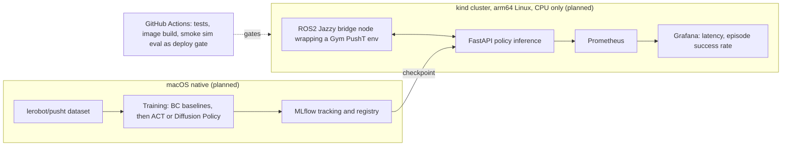

# il-pusht-k8s

## Goal

**Target** (not yet achieved): trained and evaluated imitation-learning policies in simulation, deployed on Kubernetes with CI/CD and monitoring.

The task is PushT (`gym-pusht`), with the public `lerobot/pusht` dataset. Current status: environment, repo skeleton and a reference-policy run are done; everything else is on the Roadmap below. This is a learning project in simulation only: not production, not VLA fine-tuning, not real-robot work.

## Results

Only measured numbers are listed. No policy of my own has been trained or evaluated yet.

**Reference policy: `lerobot/diffusion_pusht`. Pretrained by LeRobot authors, not my result.** I only ran it, via `lerobot-eval`, to check the pipeline and time the hardware (MacBook Pro, Apple M3 Pro, 18 GB unified memory; LeRobot 0.6.1, torch 2.11.0). Episodes are capped at 300 steps.

| Device | Episodes | s / episode (sim + policy) | Success |
|---|---|---|---|
| CPU | 2 | 133.5 | 50% (noise) |
| MPS | 2 | 101.1 | 50% (noise) |

- MPS is about 1.3x faster than CPU for the full eval loop.
- With 2 episodes per device, the success rate is noise. It is not a measured success rate.
- Not done yet: N=50 fixed-seed evaluation, any own policy (BC or ACT/Diffusion Policy), failure analysis, latency measurements.

Dataset facts (`lerobot/pusht`): 206 episodes, 25,650 frames, 10 fps; `observation.image` 96x96x3, `observation.state` 2D (agent position only, so the T block pose is visible only in the image), `action` 2D.

## Architecture

**PLANNED design. Nothing below is built yet** (the repo currently holds the folder skeleton, environment setup and a checkpoint-migration script).



Notes on the plan: the ROS2 part is a bridge node wrapping a Gym environment, not a ROS-native simulator. MPS is not available inside Docker on macOS, so containers run on CPU. Deployment uses Helm on kind. Monitoring uses lightweight Prometheus and Grafana charts. The CI gate is a short smoke eval (10-20 episodes), not a statistically strong benchmark.

## Roadmap

| Item | Status |
|---|---|
| Environment, repo skeleton, one-command setup (`make setup`) | Done |
| Reference policy run, CPU vs MPS timing (2 episodes each) | Done |
| Own demo data (public `lerobot/pusht` is used first) | PLANNED |
| BC baselines: state-only MLP (floor) and CNN+MLP on image+state | PLANNED |
| ACT or Diffusion Policy trained by me | PLANNED |
| MLflow tracking, small Optuna sweep | PLANNED |
| Evaluation harness: success rate over N=50 fixed-seed episodes plus max-coverage reward, baseline comparison, failure analysis | PLANNED |
| ROS2 bridge node (Jazzy, in Docker) | PLANNED |
| Containerized FastAPI inference, kind cluster, Helm chart | PLANNED |
| Prometheus + Grafana (inference latency, episode success rate) | PLANNED |
| GitHub Actions CI with smoke-eval deploy gate, MLflow registry | PLANNED |
| Architecture write-up, demo GIF | PLANNED |

`make train`, `make eval` and `make deploy` are placeholders that exit with "not implemented". The success threshold of the environment (believed to be 95% coverage) is not yet verified in the env code.

## Learning-scale vs industry-scale

Learning-scale (what this is): one laptop, simulation only, a 2D PushT task, a public 206-episode dataset, CPU/MPS training, a single-node kind cluster, a short smoke eval as CI gate, 2-3 hours of work per week.

Industry-scale (what this is not): real robots or hardware-in-the-loop, GPU clusters and multi-GPU training, large own-collected datasets, statistically strong benchmarks, multi-node production clusters with full observability stacks, SLAs and on-call.

## Setup

Tested on Apple Silicon (M3 Pro, macOS). Needs Python 3.12 and ffmpeg.

```bash
git clone git@github.com:rehmanazeem/il-pusht-k8s.git && cd il-pusht-k8s
conda create -n il-pusht -c conda-forge python=3.12 ffmpeg
conda activate il-pusht
make setup        # pip install -r requirements.lock -e .
```

Check:

```bash
python -c "import torch; print(torch.backends.mps.is_available())"   # True on Apple Silicon
lerobot-eval --help
```

### Reference checkpoint

`lerobot/diffusion_pusht` uses the old checkpoint format, which LeRobot 0.6.1 cannot load.
Migrate it once with the workaround script:

```bash
python scripts/migrate_pusht_ckpt.py --pretrained-path lerobot/diffusion_pusht \
  --output-dir outputs/models/diffusion_pusht
```

### Known warnings

Harmless: a duplicate `libavdevice` warning (`opencv-python` and `av` both bundle it) and a
torchcodec `libavutil` warning (falls back to pyav).
